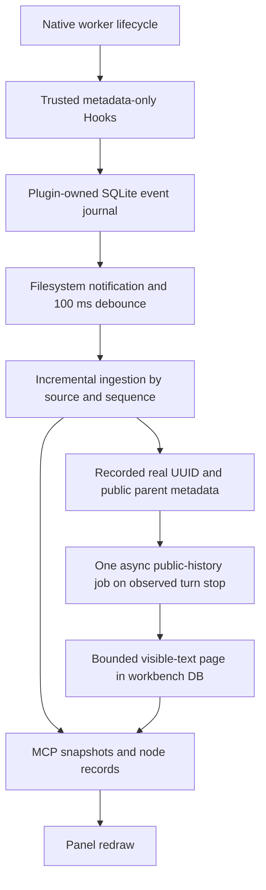

# Data flow, synchronization and timing

Status: 0.5.2 development source; installed-host UI acceptance remains pending. This report separates
actual API measurements, executable source tests and the remaining host checks.

## What caused the model round trips

In 0.5.1, task CRUD, filters and global refresh already used direct MCP calls.
Four node actions still used `ui/message`: runtime verification, navigation,
continuation, and identity/history synchronization. This made an ordinary read
wait for the main model to process an instruction and call more tools.

A bound history request required a lead `read_thread` and page import, followed
by a panel record refresh. An unbound node additionally required reading the
recorded spawning parent's activity and binding its exact child UUID. The old
Skill also requested history work at dispatch/completion. These are code-derived
call paths, not measured durations of the user's current chat.

0.5.2 removes the main model from ordinary reads and synchronization. Explicit
execution/continuation remain lead operations because this MCP App has no
verified direct entry to the current spawning model's internal collaboration
namespace. They use compact request IDs plus `team_get_request`, rather than
copying task instructions and unrelated board/history into messages. Optional
lead-assisted identity/navigation/history are visibly labeled and never silently
invoked after a direct-path failure.

## Event-driven backend

Automatic visible-history sync is confirmed once per workbench/root. Existing
boards default off. Changing the root invalidates that consent; archiving or
disabling prevents new pages from being saved. No Hook scope or trust setting
is changed. Only the configured plugin-owned journal is watched; no native
session directory, database or credential is accessed.

The watcher ingests only unseen journal sequences. Running/idle come from actual
Hook metadata; a turn stop is not task success. Each stopped event has a stable
key including binding, native UUID, ancestry and turn observation. The backend
uses one asynchronous history helper per backend at a time, deduplicates pending/completed work and
persists keys across new MCP connections. Shared SQLite job leases prevent two
connections from reading the same event concurrently; independently opened Store
connections exercised that guard. Leases expire after 30 seconds on a crash.
The metadata-only Hook entry disables this runtime; only the MCP backend performs
history jobs. Its watcher starts/closes with that backend connection, and later
connections recover using persisted keys. Failed work retries at most three
times per key. A stopped turn not yet persisted by the public history store is
retried; an unrelated or empty turn is not imported as that event's result.

Before body access, the existing public control socket verifies the complete
recorded parent chain, then calls `thread/turns/list`. This is a stored-history
read, not a second worker/runtime and not desktop live status. Pages contain at
most one turn and bounded user/assistant text, with omission/truncation labels.
Reasoning and tool bodies are not emitted to the plugin's Node process or saved.

The UI still fetches MCP snapshots on its existing 2.5-second interval. This is
local data refresh, not model polling. Its visible delay includes the backend
job plus the next UI tick. A missed OS file notification is recovered by the
existing snapshot-ingestion path. The current implementation fetches visible
pages on turn stop; it does not provide token-by-token tool/answer streaming.

## Measurements and evidence

| Check | Observed result | Scope |
| --- | --- | --- |
| Explicit direct read, existing real authorized child | 737 ms first read, 676 ms repeat; expected child-result marker; repeat record deduplicated | Real public API and isolated workbench DB; no new worker |
| Background watcher to saved real child history (recorded-event replay) | 1815 ms; one history read; zero backend model calls | A recorded stop was replayed into an isolated journal; actual OS watcher and public history API |
| Fresh native execution and same-agent continuation | One newly spawned native worker, two actual completed turns, one stable UUID; automatic pages saved 1158 ms and 1021 ms after their native stop records | Existing trusted root-scoped development probe, isolated workbench and real public history; no replay/manual history-sync request for these two turns. Native parent used real collaboration; test bridge relayed execution/action receipts |
| Hook journal watcher, start/stop, duplicate events | Actual file notifications and source handlers passed; no snapshot call needed to trigger persistence | Synthetic Hook payloads and deterministic public-reader fixture |
| Disable/rebind during a pending read, retry cap, history persistence lag, restart dedupe | Executable isolation tests passed | Does not certify a real desktop UI |
| Main-chat/model portion of an old user operation | Not separately timed | Repeated tool/model hops are evident from the old source and reported user experience; no invented latency attribution or percentage |
| Official native navigation | Actual navigate_to_codex_page returned navigated=true for the fresh real child; parent-side receipt also recorded | API acknowledgment, not a visual check or the iframe open-link route |
| Current host's iframe direct child navigation | Not tested | Needs a real expanded host frame, advertised openLinks and an actual ui/open-link response |

Private run evidence is kept under `artifacts/buttons-0.5.2`, excluded from the
public file allowlist. Exact thread UUIDs, real work records and raw replies are
not included in this document or the public source. Regression totals are in
the local test logs; a test count does not substitute for the pending host check.

## DSH's actual mechanism

In pinned DSH commit `ce7073d51254c26cd63b22a60835b8f948deb447`:

- `client-ui-agent-team/src/client/TeamAction.tsx` reads `agentTeam` from session
  projections and runtime state from `useSessionStatus`/session summaries.
- `api/session-controller/src/client/sessions/manager.ts` implements
  `refreshProjections`; this is a session-service read, not a model instruction.
- `client-ui-agent-team/src/client/mount.ts` implements member opening with
  `uiWorkspace.openSession({parentSessionId, childSessionId, mode: continuable})`.

DSH owns those session/UI services. Reusing their behavior here means direct
plugin data calls, metadata events and a bounded public history reader. It does
not mean calling DSH's internal Cordis service names in a Codex iframe.
The remaining platform-specific part is native host navigation: this source
negotiates `openLinks`, requests `ui/open-link` with the exact native URL and
records refusal/acknowledgment. Current-host scheme acceptance must be measured.

Further improvements should target transport/data updates: publish small revision
deltas to the UI rather than complete snapshots, reuse a bounded helper if its
startup is shown material, and add a real scoped host event stream if supported.
They should not ask the main model to maintain cache state or poll conversations.
The current sub-second read measurement does not justify claiming helper startup
is the main bottleneck.

See [all button paths and host gate](BUTTON_ACTIONS_0.5.2.md) and
[interface matrix](INTERFACE_MATRIX.md).

## Latest real-host checkpoint

The actual new worker emitted SubagentStart, PreModelRequest and SubagentStop;
its continuation emitted new PreModelRequest/Stop records without another spawn.
Public parent activity and the two child pages independently confirmed the same
native UUID. The isolated task/run reached completed/succeeded; continuation and
native-navigation receipts were stored. A test-harness omission of the worker
start receipt was corrected before continuing the same agent; no substitute was
created. The source task state machine correctly rejected that initially invalid
result-report order. These test-bridge receipts remain caller-reported evidence.

The original test chat was temporarily restored and then returned to archived
through the actual owning host's set_thread_archived API. The separate public
control process refused to archive a thread with an active writer; that error
was respected. No alternate Codex CLI, forced lock cleanup or host restart was
used. Original workbench bindings remained archived, and all test writes used
an isolated data directory.

This new callback proof used the existing trusted development probe. Deployment
of the packaged 0.5.2 Hook command and its actual UI remains unverified. Terra
xhigh checked the supported MCP Apps browser, which existed but returned an
empty tab list. No Team Workbench frame was available to inspect. Windows
Computer Use guidance prohibits controlling the outer ChatGPT/Codex UI, so the
agent did not switch to that route. The user must first expand the App in this
task's side panel; loading/updating 0.5.2 still requires its authorized native
installation workflow. No claim of complete client acceptance is made.
